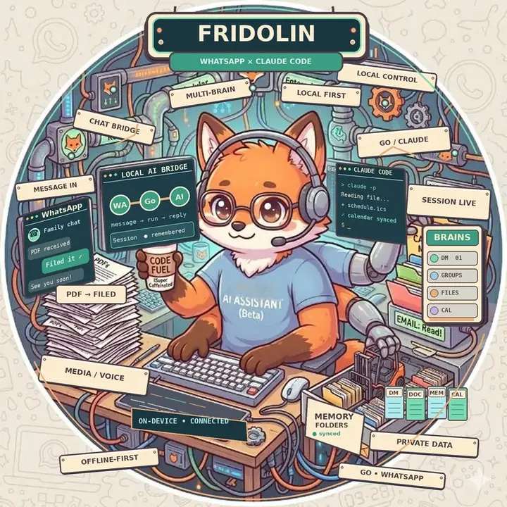

<p align="center">
  
</p>

# Fridolin

Talk to [Claude Code](https://claude.com/claude-code) or [Codex](https://learn.chatgpt.com/docs/codex/cli) over WhatsApp.

Message it like you'd message a person. It reads and writes files, runs
commands, and remembers things between conversations. Send it a PDF and it
files it. Ask what's on your calendar. Add it to a group and it follows along,
answering when addressed and staying quiet otherwise.

```
WhatsApp  ──►  bridge (Go)  ──►  claude -p   ──►  your files
   ▲              │                              your tools
   └──────────────┘                              your calendar
     replies, polls
```

It runs on your own machine, linked to a WhatsApp account as a companion
device — the same mechanism as WhatsApp Web. No third-party server sees your
messages.

> **This gives an AI assistant real access to your computer, driven by
> messages from a chat app.** Read [Security](#security) before you run it.

---

## What it does

**Choose the assistant.** Settings → AI mode switches all brains between
Claude (the default) and Codex. Codex defaults to GPT-6.1 Sol with high
reasoning effort. Each brain needs its own Codex sign-in; see
[AI mode](docs/CONFIGURATION.md#ai-mode). Switching keeps its files and chat
history, and preserves your Claude model settings.

**Conversations that continue.** Each chat keeps its own history. The
assistant sees the recent part of it and can search the full log.

**A dashboard.** Everything is set up in a local web page: pair WhatsApp by
scanning a QR code, add brains, allow chats, watch messages arrive and runs
finish, change settings, read the log. Nothing to edit by hand.

**Brains.** A brain is one isolated assistant: its own folder, prompt,
memory, and history. Give your DMs a private brain and a group chat a shared
one — they can't read each other's files. Add as many as you like, any time:
pick a folder in the dashboard and it becomes a brain, no restart needed.

**Your data stays yours.** Brains live in ordinary folders on your machine,
not in this repository. Link Google Drive in the dashboard and each brain is
backed up incrementally every night, with old versions kept.

**Files.** Photos, PDFs, documents, voice notes, and video are downloaded and
handed over as file paths, in an inbox of the brain's own that no other brain
can open. The assistant opens them and does whatever you asked.
A file over 100 MB (`max_media_mb`) is skipped, and so is one that cannot be
downloaded within two minutes; the sender is told either way. View-once photos,
videos and voice notes are not opened (the sender is asked to send a normal
one); a shared location or contact card reaches the assistant as text.

**Real polls.** The assistant can send native WhatsApp polls and read the votes
back; each vote lands in its chat history, so it sees new votes the next time
someone writes:

```
[POLL]
Question: When should we meet?
- Monday 2pm
- Tuesday 3pm
[/POLL]
```

**Group awareness.** In a group it keeps up with everything, through its chat
history, but runs and replies only when addressed — by keyword, by
@-mention, by a reply to one of its messages, or when you send it a file
(each brain can turn files and forwards off).

**Orderly.** Messages that arrive while the assistant is busy wait their turn
(or, if you prefer, a newer request replaces the one you sent before it). A
photo album or a file plus "what is this?" sent in quick succession becomes
one request. `!stop` stops whatever it is doing for that chat. A reply written
while the connection is down goes out once it is back, even after a restart,
and the next message is answered knowing it. A message you delete for everyone
is not answered, even while it is being answered, and leaves the chat history
(an answer already written, waiting for the connection, still goes out); an
edit of one still waiting changes what is answered, and an edit of one already
answered is noted for the next message, without a second run.

**Calendar.** Each brain can sign in to a Google account from the dashboard
and use the calendars you pick: list events, find free time, create events.

**Scriptable.** Localhost endpoints let your own scripts send messages through
the bridge — nightly summaries, alerts — or hand a brain files that arrived
some other way.

**Your own site.** Optionally, a website of your own on your domain: people
sign in with Google or a password, and each page is a module in a private
repository you link in the dashboard. Nothing goes live until you approve it.
See [docs/SITE.md](docs/SITE.md).

---

## Requirements

- **macOS or Linux.** The sandbox layer is macOS-only; everything else is portable.
- **[Claude Code](https://claude.com/claude-code)** 2.1.302 or newer, installed
  and logged in. With the sandbox (macOS), brains log in with a token in the
  bridge's environment instead: `claude setup-token` prints one (see
  [where to set it](docs/CONFIGURATION.md#where-to-set-them)).
- **Go 1.26+** and a C compiler to build (`xcode-select --install` on macOS).
- **Python 3.9+** for the helper tools.
- **A current browser** for the dashboard: Chrome or Edge 123+, Firefox 120+
  or Safari 17.5+.
- **[rclone](https://rclone.org/install/)** — only for Google Drive backups.
- **A WhatsApp account for the bridge.** Use a second number, not your personal
  one — see below.

### Use a second phone number

The bridge answers automatically as whichever account it is linked to. Linking
your personal account means your own chats become the assistant's inbox and
your contacts get replies from "you".

Get a cheap prepaid SIM or a second number, register WhatsApp on it, and link
the bridge to that. Then add that number to your groups, or DM it from your own
phone.

---

## Setup

```bash
git clone https://github.com/YOUR_USERNAME/fridolin.git
cd fridolin
./setup.sh
```

Or open the folder in Claude Code (or any coding assistant) and say *"set this
up"* — [AGENTS.md](AGENTS.md) tells it exactly what to do.

`setup.sh` checks the prerequisites, builds the bridge and runs the tests on
the build. Only then does it install it, to `~/.local/lib/fridolin/`, with a
background service (launchd on macOS, a systemd user unit on Linux) that runs
it from there, and open the dashboard. The checkout only builds, so working in
it never changes the running bridge. Re-run it any time; it leaves your
configuration and brains alone. `./setup.sh --help` lists its options.

The commands below are `~/.local/lib/fridolin/fridolin`, shortened to
`fridolin`: put that folder on your `PATH`, or type the full path.

Then, in the dashboard:

1. **Pair WhatsApp.** A QR code is shown. On the phone holding the bridge's
   account: **Settings → Linked Devices → Link a Device**, and scan it. The
   pairing is stored, so this is a one-time step.
2. **Add a brain.** Choose a folder (an empty one, or one you already keep
   notes in). The bridge writes a `brain.json` and a starter prompt into it and
   never overwrites existing files. Decide whether it answers your DMs.
3. **Allow your number** under *Chats → Allowed numbers*, then DM the bridge.
4. **Optional:** *Backup → Connect Google Drive*.

Reopen the dashboard any time with:

```bash
fridolin open
```

It asks the running bridge for a link that signs your browser in and works
once, within a minute; the browser then stays signed in for 30 days.
*Settings → Dashboard sign-in* signs it out, or signs out every browser and
replaces the dashboard token (`fridolin rotate-token` does the same).

### Upgrading and rolling back

```bash
git pull && ./setup.sh
```

builds and tests the new version, installs it and restarts the bridge, which
cuts off any reply it is working on. The version it replaced stays next to it,
with its tools, as `fridolin.prev`. To go back to it:

```bash
fridolin service rollback     # run it again to undo
```

[docs/COMPATIBILITY.md](docs/COMPATIBILITY.md) lists what an upgrade
keeps working (`config.json`, `brain.json`, the history files,
`bridge.db`, `/send` and `/ingest`, the commands) and how something is
retired; [CHANGELOG.md](CHANGELOG.md) what changed.

**Coming from a version without API tokens** (one whose `/ingest` took
none): `POST /ingest` now refuses a call without a token with `401`, so an
upload handler or recorder sync written for the old version stops working
until it sends yours:

```bash
curl -X POST http://127.0.0.1:8765/ingest \
  -H "Authorization: Bearer $(cat ~/.fridolin/scripts.token)" …
```

`/send` without a token keeps reaching your allowed chats while
[`script_api.tokenless_send`](docs/CONFIGURATION.md#script_apitokenless_send)
is on, which it is in a config written before tokens. Before you turn it
off, give your scripts that header too, and change brain instructions that
`curl …/send` without one to send their run's token to
`"$FRIDOLIN_API/send"`, as [Isolation](docs/BRAINS.md#isolation) shows.

**Coming from a version without dashboard sign-in** (one whose
`fridolin open` put the token in the link): the token stays the same, and
copies of it may still sit in your browser's history and storage, where a
brain could read them (see [Dashboard](docs/CONFIGURATION.md#dashboard)).
Once the new build runs, replace it once:

```bash
fridolin rotate-token     # or Settings → Dashboard sign-in → Sign out everywhere
```

Scripts that send the old token in `X-Bridge-Token` are refused from then
on; give them the new one from `~/.fridolin/dashboard.token`. The upgrade
does not rotate it for you, so that those scripts do not stop without
warning.

**Coming from a version whose sandbox let brains write outside their
folders** (one without media inboxes): sandboxed brains now write only
their own folder, their inbox and their own state in
`~/.fridolin/brains/<id>/`, and cannot read your keychain, so the login
you made with `claude` no longer reaches them. Before you upgrade, run
`claude setup-token` and set the token as `CLAUDE_CODE_OAUTH_TOKEN` in the
service's environment
([where to set them](docs/CONFIGURATION.md#where-to-set-them)); until
then brains answer "Not logged in", and the dashboard warns. Unless
`inherit_claude_user_config` is on, each brain starts with an empty Claude
Code config folder of its own: its CLI settings, todos and the
transcripts of its earlier runs stay in `~/.claude`, where it can no
longer read them, while its folder, memory and conversation history are
untouched. A skill that writes to `/tmp`, or installs programs or global
packages, fails now: `$TMPDIR` is the brain's own temp folder
([details](docs/CONFIGURATION.md#writing)). On the first start what
older versions left in the media folder moves to `media/.old/`, which no
brain can read: its folders, `media/plaud/` with every brain's Plaud
transcripts and a script's own folder among them, and the files at its
top, every chat's attachments. A script that hands files to `/ingest`
writes them to the top of the media folder; one it left there before the
upgrade is in `media/.old/` too.

`fridolin version`, the dashboard's Overview and the `Starting fridolin …`
line each start writes to the log say which version runs (on macOS:
`grep 'Starting fridolin' ~/Library/Logs/fridolin/stderr.log | tail -1`).
`fridolin service status` shows what is installed, what the service runs
and whether the bridge answers.

### Adding a group

1. Add the bridge's account to the group and send any message there.
2. The group appears in the dashboard under **Chats → waiting for access**.
3. Click **Allow**, pick the brain that should handle it, and say
   `@claude hello` in the group.

### Brain folders

A brain is a folder with a `brain.json`:

```json
{
  "version": 1,
  "id": "family",
  "name": "Family",
  "routing": { "handles_dms": false, "default": false, "groups": ["120363000000000000@g.us"] },
  "effort": "medium",
  "backup": { "enabled": true, "exclude": ["node_modules/", "*.log"] }
}
```

Copy a brain folder to another machine (or restore it from Drive), add it in
the dashboard, and it comes back with its settings. The bridge runs the
version you approved in the dashboard: if a brain edits its own `brain.json`,
the dashboard shows the change and waits for you. See
[docs/BRAINS.md](docs/BRAINS.md).

### Configuring by hand

The dashboard writes `~/.fridolin/config.json`; you can edit it
too. Every option is documented in [docs/CONFIGURATION.md](docs/CONFIGURATION.md).

```bash
fridolin check                           # validate; show who is heard, and the routing
fridolin check --route 15551234567@s.whatsapp.net
```

### Trying it without WhatsApp

```bash
make build && bin/fridolin --no-whatsapp --config /tmp/try/config.json --open
```

A build in `bin/` finds the tools in the checkout and leaves the installed
bridge alone. Give the scratch config its own `http_listen` port and
`data_dir`.

Dev mode runs the dashboard and brains with a simulated chat: inject messages
on the **Dev** page and read the replies there. They pass the same allow
lists, `group_members` and triggers as WhatsApp messages, so a message to a
group needs a sender the group admits; the page says when the bridge
ignored one, and why.

---

## Using it

**Direct message** — just write. Attach files, ask questions, give it work.

**In a group** — start with your trigger keyword (`@claude` by default),
@-mention the bridge's account, or send a file.

**Commands**

| Command  | Effect |
| -------- | ------ |
| `!help`  | Show available commands |
| `!stop`  | Stop the run for this chat and drop its queued messages, including files or recordings another brain is answering here |
| `!reset` | Like `!stop`, and the chat starts afresh: the next message's run sees none of the chat's earlier messages. The history file keeps them, and what the assistant wrote in its memory files stays |

A command also works when sent as a reply to a message.
In a group, address the bridge as for any request (`@claude !stop`, or
@-mention its account): an untagged `!stop` is ordinary chatter. Commands act
only on the chat they were sent in: one brain often serves several chats, and
a `!stop` in a group leaves your DM alone. The dashboard's *Stop* buttons act
on the whole brain. Any member of an allowed group can send an addressed
command there; it affects only that group's work.

### Shaping the assistant

Each brain's personality lives in `brain-prompt.md` in its folder. Adding a
brain writes a starting version from
[examples/brain-prompt.example.md](examples/brain-prompt.example.md). Edit it —
tell the assistant who you are, how to write, what it looks after. This is the
file that matters most for how good the thing feels.

### Memory

The assistant does not remember previous runs. Each message is a fresh Claude
process that gets the recent chat history (since the chat's last `!reset`)
and nothing else. Continuity comes from files it writes itself:

```
<brain folder>/
├── brain.json                    routing and settings (managed by the dashboard)
├── brain-prompt.md               sent ahead of every message — edit this
├── conversation-history.jsonl    every message, appended automatically
├── skills/                       procedures for recurring work
└── memories/                     notes the assistant writes for itself
    └── people/
        └── whatsapp-identity-map.md   phone numbers → names
```

Anything older than the recent window is searchable. A brain runs
`"$FRIDOLIN_BIN" history` in its own folder; from your shell, name the
folder:

```bash
fridolin history --brain-dir ~/assistant/personal --since 30d "invoice"
```

### Skills

A skill is a markdown file in a brain's `skills/` directory telling the
assistant when a piece of recurring work applies and exactly how to do it —
which command, which flags, which mistakes not to make. The assistant reads
them before starting routine work, and writes new ones as it finds patterns.

Three ship with the bridge and are copied into each new brain:

- **[transcription](examples/skills/transcription.md)** — audio and video to
  text, including the reasons not to hand-roll it
- **[media-management](examples/skills/media-management.md)** — filing photos,
  clips, and voice memos out of the staging directory
- **[plaud](examples/skills/plaud.md)** — filing recordings from a Plaud
  recorder ([docs/PLAUD.md](docs/PLAUD.md))

They're starting points. Edit them, and add your own.

### Transcription

`tools/transcribe.py` handles voice notes and recordings of any length: it
pulls audio out of video, splits long files into chunks, and runs a local
Whisper model or the Groq API (sending 16 kHz mono FLAC, retried with backoff
by Groq's SDK).

```bash
~/.local/share/fridolin/venv/bin/python tools/transcribe.py voice-note.ogg --output-dir ~/assistant/personal/transcripts
```

Neither engine is installed by default. Pick one and install it into a venv
of its own, the one the transcription skill runs the tool with; Homebrew's
and Debian's Python refuse a plain `pip install` (PEP 668). Keep it out of
`~/.fridolin`, which brains cannot read:

```bash
python3 -m venv ~/.local/share/fridolin/venv
~/.local/share/fridolin/venv/bin/pip install -r tools/requirements-transcription.txt   # local: private, ~1.5 GB model
~/.local/share/fridolin/venv/bin/pip install groq && export GROQ_API_KEY=...           # API: light, needs a key
```

With [uv](https://docs.astral.sh/uv/), `uv run --script tools/transcribe.py
voice-note.ogg …` does without the venv: it installs both engines, as the
script's own metadata lists them, into uv's cache.

Brains get `GROQ_API_KEY` from the bridge's process environment, and only
when [`child_env_passthrough`](docs/CONFIGURATION.md#child_env_passthrough)
names it: `"child_env_passthrough": ["GROQ_API_KEY"]`. The bridge reads no
`.env` file. [Environment
variables](docs/CONFIGURATION.md#environment-variables) says where to keep it
so that the next install does not drop it.

`ffmpeg` is required either way. `--model` accepts any Whisper-compatible model
ID, so a fine-tune matching your language or dialect usually beats the default
by a wide margin.

### Sending messages from a script

```bash
curl -X POST http://127.0.0.1:8765/send \
  -H "Authorization: Bearer $(cat ~/.fridolin/scripts.token)" \
  -H 'Content-Type: application/json' \
  -d '{"jid":"120363000000000000@g.us","text":"Deploy finished ✅"}'
```

The token in `~/.fridolin/scripts.token` is your scripts'. A brain
sends its run's, from the file `$FRIDOLIN_BRAIN_TOKEN_FILE` names, and may
send only to its own chats.
Without a token, `/send` reaches only your allowed chats, and only while
[`script_api.tokenless_send`](docs/CONFIGURATION.md#script_apitokenless_send)
is on. `jid` may also be a phone number with the country code, for the
direct chat with it.

`curl -fsS http://127.0.0.1:8765/ready` succeeds only while WhatsApp is
connected, so a script can check first; its JSON names the connection state
and the bridge's version.

To hand a brain files that arrived some other way (a web upload, a recorder
sync), write them to `~/.fridolin/media/` itself, not to a folder in it,
and turn on `ingest.enabled`. The brain takes them into its own inbox,
`~/.fridolin/media/<brain id>/`. A file in any folder of the media folder
is refused, unless it is already in that brain's own inbox: those folders
hold files for brains (another brain's inbox, one a removed brain left),
which a brain could otherwise ask for itself. A brain that calls with its
own run's token hands in only what is in its own inbox:

```bash
curl -X POST http://127.0.0.1:8765/ingest \
  -H "Authorization: Bearer $(cat ~/.fridolin/scripts.token)" \
  -H 'Content-Type: application/json' \
  -d '{"brain":"personal","paths":["/Users/you/.fridolin/media/scan.pdf"],"text":"File this"}'
```

The brain you name handles it like a WhatsApp attachment and replies in its
reply chat (`reply_chat`, or the default described in
[docs/BRAINS.md](docs/BRAINS.md)), even when that chat belongs to another
brain. Both endpoints only listen on localhost and refuse requests a web page
sends. [docs/API.md](docs/API.md) is their full contract.

### Google Calendar

Dashboard → *Brains → brain → Calendar → Connect Google Calendar*: sign in
with the account for that brain and tick the calendars it may use. It needs a
Google OAuth client, which you create once in Google Cloud Console and paste
under *Settings → Google sign-in*. Step by step:
[docs/CALENDAR.md](docs/CALENDAR.md).

### Plaud recorder

Record conversations with a Plaud? Dashboard → *Integrations → Plaud* signs in
with Plaud's own login, and every new recording reaches a brain as a finished
transcript with Plaud's summary. A NotePin can also skip Plaud's slow cloud
sync: the Android app in [plaud-android/](plaud-android/README.md) pulls
each recording off the pin as it stops and uploads its transcript through
your site; the Plaud card builds and pairs it. See [docs/PLAUD.md](docs/PLAUD.md).

### Backups

*Backup → Connect Google Drive* links a Drive account through
[rclone](https://rclone.org). The bridge keeps its own rclone configuration
(your personal rclone setup is untouched) and asks only for the `drive.file`
permission, so it can see nothing in your Drive except the files it creates.

Every night (or when you click *Back up now*) each brain folder is synced
incrementally to `fridolin-backup/<brain>/current/`; files that changed or
were deleted move to `versions/<timestamp>/` and are kept for 30 days after
that run. A run that would mirror a mass deletion (an empty brain folder, many
of its files gone, or most of one of its folders, such as a wiped
`memories/`) is refused until you force it, and the first
nightly refusal tells you on WhatsApp. Exclude patterns per brain keep out
what you can rebuild. The WhatsApp session and tokens are never uploaded,
nor `.env` files and private keys in brain folders. Restores go into a new folder and never overwrite a brain. Details:
[docs/BACKUP.md](docs/BACKUP.md).

### Running in the background

`setup.sh` runs `fridolin service install`, which you can also run yourself.
It copies the binary and the Python tools to
`~/.local/lib/fridolin/` and writes a launchd agent
(`~/Library/LaunchAgents/ai.fridolin.bridge.plist`) or a systemd user unit
(`~/.config/systemd/user/fridolin.service`) that runs it with your shell's
`PATH`, then restarts it and checks that the new version answers. Pairing
happens in the dashboard, so the service can start before WhatsApp is linked.

```bash
fridolin service status       # what is installed and running
fridolin service restart
fridolin service install --dry-run   # show the unit without writing it
fridolin service uninstall    # remove the service and the install, not your data
```

Each install rewrites the unit. Variables you add to the launchd agent's
`EnvironmentVariables` are kept (a dry run names them, but does not show
their values); on Linux keep them in a drop-in: see
[Environment variables](docs/CONFIGURATION.md#environment-variables). The
macOS log is `~/Library/Logs/fridolin/stderr.log` (`tail -F` it), private to
you; past 10 MB it moves to `stderr.log.1`, replacing the one before. On
Linux, `journalctl --user -u fridolin -f`.

### Releases

Each version tag (`v1.2.3`) builds archives for macOS (arm64, amd64) and Linux
(amd64, arm64) on the project's GitHub releases page, with a `SHA256SUMS`
file. To run one without building it yourself, download the archive for your
machine and `SHA256SUMS`, then:

```bash
shasum -a 256 -c SHA256SUMS --ignore-missing     # Linux: sha256sum -c --ignore-missing SHA256SUMS
tar -xzf fridolin_v1.2.3_darwin_arm64.tar.gz && cd fridolin_v1.2.3_darwin_arm64
./fridolin init                                   # a starter config, if you have none
./fridolin service install                        # installs the binary and tools/ next to it
```

The macOS archives are not signed or notarized, so Gatekeeper blocks a
`./fridolin` from an archive your browser downloaded: download with `curl -LO`,
or run `xattr -d com.apple.quarantine fridolin` after unpacking. The Linux
archives are built on Ubuntu 22.04 and need its glibc (2.35) or newer: Ubuntu
22.04, Debian 12 and later run them; on an older system, build from source.

`scripts/build-release.sh` builds the same archive locally. A maintainer
releases by pushing a tag: `git tag v1.2.3 && git push origin v1.2.3`.

---

## Security

The bridge runs Claude Code with `--dangerously-skip-permissions`, because
nobody is at the keyboard to approve tool calls. The assistant can read and
write files and run commands without asking.

That means **anyone who can message the bridge can influence what it does on
your machine**, and so can text inside any file they send it. Treat it that way.

What the bridge does about it:

- **DM allowlist.** Only numbers in `allowed_numbers` are answered; an empty
  list answers nobody unless you set `allow_any_dm` to `true`.
- **Group allowlist, per member.** Groups are deny-by-default: unlisted
  groups are ignored entirely. In an allowed group only the members
  `group_members` admits are read: the numbers it lists for that group, or
  everyone for `["*"]`, and without an entry whoever may DM the bridge
  (`allowed_numbers`). Anyone else can neither start a run nor stop one, and
  what they write is not read, not even into the brain's history, unless an
  admitted member quotes or forwards it. A member WhatsApp names only by an
  internal ID, without their number, gets in only where everyone does
  ([details](docs/CONFIGURATION.md#group_members)).
- **No Status or channels.** WhatsApp Status updates and channels are ignored,
  and the bridge refuses to send to Status, broadcast lists or channels, so
  nothing the assistant writes can end up in your public Status.
- **Sandbox (macOS).** Each Claude run is wrapped in `sandbox-exec`.
  Brains may write only their own folder, their own media inbox and the
  state the bridge keeps for each of them (a Claude Code config folder,
  `TMPDIR` and caches of its own), so nothing they write runs outside the
  sandbox: not Claude Code's settings and hooks, a `CLAUDE.md`, a
  LaunchAgent, a shell startup file, your apps' preferences, a program on
  your `PATH`, nor the bridge's own binary, install folder and checkout. They cannot read SSH
  keys, the keychains, cloud credentials, shell history, browser and mail
  data, your Documents/Downloads/Desktop, the bridge's own database, any other
  brain's folder or inbox, nor your Claude Code setup and transcripts and
  your instructions above their folder (`~/CLAUDE.md` and every
  `CLAUDE.md` up to `/`) unless `inherit_claude_user_config` is on. Add
  your own paths under `sandbox.deny_paths`. When the sandbox is on but
  cannot be set up, the brain refuses the message with an error instead of
  running without it.
- **An explicit environment.** Brains are handed only the variables of the
  bridge's environment they need to run, such as the Claude CLI's login,
  not every key in the service file or the shell that started it. That is
  no secret store: a brain that goes looking can still read the service
  file and the bridge's environment, so keep anything a brain must not see
  out of both; see
  [what reaches brains](docs/CONFIGURATION.md#what-reaches-brains).
- **Brain isolation.** Brains have separate folders, memories, histories
  and calendar credentials, and they do not load your own Claude Code
  setup: your user settings and their hooks, skills, plugins and MCP
  servers, or the `CLAUDE.md` files above their folder, `~/CLAUDE.md` and
  `~/.claude/CLAUDE.md` included (and, with the sandbox, nothing else from
  the `.claude` folders above it either; see
  [what a brain loads](docs/BRAINS.md#what-a-brain-loads)).
- **A guarded dashboard.** It only listens on localhost, rejects requests
  from web pages on other sites (and DNS-rebinding tricks), and requires a
  token from `~/.fridolin/dashboard.token`. Browsers never hold the token:
  they sign in with a link that works once and keep a session, a cookie
  page scripts cannot read that counts only together with a key the
  dashboard page keeps for its own address. On macOS the sandbox keeps
  the token file away from brains, so a manipulated brain cannot
  reconfigure the bridge; the browser's files, where a session is kept,
  it denies them only for the common browsers
  ([which ones](docs/CONFIGURATION.md#dashboard)). On Linux, or with the
  sandbox off, a brain that runs with all permissions can read the token
  like any other file of yours; the dashboard warns about it.
- **Tokens for `/send` and `/ingest`.** Each brain's run gets a token of
  its own, which works while the run lasts: with it, a brain sends only to
  its own chats and hands files only to itself, so it cannot make another
  brain run with that brain's memories and credentials. Your scripts use
  `~/.fridolin/scripts.token`;
  see [docs/API.md](docs/API.md#who-may-call).
- **You approve brain settings.** A brain that edits its own `brain.json` to
  claim your DMs or another group changes nothing until you approve it.
- **OTP guard.** A message that is only a one-time code, arriving in a chat
  within ten minutes after the assistant or a script asked that chat for
  one, is dropped before it reaches history or the model — also when it is
  sent as a reply to the request or corrected by an edit — and kept in
  `<data_dir>/otp/` for ten minutes, with the id of the request it
  answers, for the local script that asked for it. The sender is told,
  unless it was untagged group chatter, which the bridge never answers.

What it does not do:

- An admitted group member is trusted like an allowed number. Any message
  of theirs that addresses the bridge (the trigger, an @-mention, a reply to
  it, a file or a forward) starts a run with every permission the brain
  has, and their untagged messages go into the history its later runs read,
  or start a run of their own when the brain's `observe` is `run`. With
  `["*"]` that is everyone in the group, including whoever its admins add
  later. `group_members` is what limits who: keep it to people you would
  let DM the bridge.
- The sandbox is containment, not a jail. It raises the cost of a prompt
  injection; it does not stop code execution. It denies reading only where
  listed, so a brain can still read the rest of your home folder. It keeps
  brains from `launchctl`, `open`, `osascript`, Apple events, Docker and
  tmux sockets, but a determined program can still talk to launchd or other
  system services directly. What a brain leaves in its own folder (git
  hooks, a `.envrc`) runs when you work there yourself. For real isolation,
  run the bridge or each brain as a macOS user of its own. See
  [what the sandbox does not cover](docs/CONFIGURATION.md#what-the-sandbox-does-not-cover).
- On Linux there is no sandbox layer at all (the bridge refuses to start with
  `sandbox.enabled` on). Run the bridge as a dedicated user: create one
  (`sudo useradd -m fridolin`), let its services run without a login
  (`sudo loginctl enable-linger fridolin`), then log in as it (over SSH, or
  `sudo machinectl shell fridolin@`; `sudo -u` gives `systemctl --user` no
  session) and run `./setup.sh` there. The unit sets `NoNewPrivileges=yes`,
  so nothing a brain starts can gain privileges through `sudo` or another
  setuid program. That keeps brains out of your own files, but not out of
  the bridge's: brains run as that user too, so they can read and change
  its token, `config.json` and WhatsApp session, and with them every
  setting.
- Every file sent to the bridge lands in your data directory, and the assistant
  reads it.

Sensible precautions: a dedicated WhatsApp number, a tight allowlist, brain
folders of their own rather than your home directory, and
`sandbox.deny_paths` covering anything sensitive.

---

## How it works

`main.go` loads config; `bridge.go` wires everything together.

**`whatsapp.go`** — [whatsmeow](https://github.com/tulir/whatsmeow) client.
Handles pairing, allowlists, trigger matching, attachment downloads, and poll
vote decryption. It keeps the list of the account's groups that the
dashboard shows (`groupcache.go`), and asks WhatsApp for it again only after
a group event or a reconnect, once it is ten minutes old, or when you press
Refresh on the Chats page. **`polls.go`** — the `[POLL]` blocks in replies,
sending them, and matching votes to options (WhatsApp sends SHA-256 hashes of
option names, which are matched against the stored options).

**`media.go`** — the media inbox: each brain's own folder in the media
directory, and moving a message's files into the inbox of the brain that
takes it.

**`debounce.go`** — merges a burst of messages from one person into one run.

**`brain.go`** — the multi-brain runner. Each brain has a queue and one
worker, which takes each chat's messages in order and the chats in turn,
and waits for one of the `max_concurrent_runs` run slots all brains share
(`runslots.go`); each message spawns `claude -p` with
`--output-format stream-json`, seeded on stdin with the brain's prompt
file and recent chat history, which `history.go` reads back from the end
of the file. Events are parsed live, so an `AskUserQuestion` reaches
WhatsApp immediately, with its options numbered (the answer comes as the
next message, and the run's final reply is sent too), and a run over 10
seconds gets a "working on it" notice (the event types are in
`stream.go`). A run is stopped at
`run_timeout_minutes`, and five seconds after its result when something it
started holds its output open. Runs are listed in `<data_dir>/runs/` while
they last, so that a bridge that crashed stops what is left of them when it
starts again. `BrainManager.Apply` swaps the brain set at runtime without
touching brains that did not change.

**`manifest.go`, `brainreg.go`** — `brain.json`, the brain registry, path
checks and scaffolding. **`configstore.go`** — the live configuration.

**`dashboard.go`, `dashboard_api.go`, `web/`** — the dashboard, its guards and
API; the page is plain HTML/CSS/JS compiled into the binary. In `web/assets`,
`app/` starts it, `pages/` holds one module per page, and `components/` and
`lib/` the pieces they share; `css/` holds its styles.

**`backup.go`** — Google Drive backups through rclone.

**`plaud.go`** — the Plaud recorder integration.

**`sandbox.go`** — generates a per-brain `sandbox-exec` profile, passed to
`sandbox-exec -p` on each run (never written to a file).

**`childenv.go`** — the one list of the bridge's environment variables that
brains, rclone, the Plaud CLI and the activity viewer get, and the state
the bridge creates for each sandboxed brain before its run: its Claude Code
config folder, `TMPDIR` and caches.

**`store.go`** — SQLite: the whatsmeow device store, polls, votes, and the
chats that wrote without being allowed.

**`chunks.go`** — splits long replies at paragraph, line, sentence, then word
boundaries so messages break somewhere readable, and numbers the parts.

**`messages.go`** — every message the bridge itself sends into chats, as
opposed to a brain's answers, pinned in `testdata/golden/messages.golden`.

**`outbox.go`** — brains' replies, and the questions they ask mid-run,
wait in `bridge.db` until WhatsApp took every message of them, are tried
again with backoff (from the message that failed, and at once when
WhatsApp reconnects, after a restart too), and go into the brain's history
only once delivered, as what the chat got (a poll as its question and
numbered options); until then a run reads them from the outbox. One that
cannot go out within an hour is given up on, and the Overview says so.

**`server.go`** — the localhost `/send` and `/ingest` endpoints.

**`otp.go`** — the OTP guard: a one-time code a chat was just asked for
is kept out of the history and the model, and handed to the script that
asked for it through `<data_dir>/otp/`, until it expires.

**`brainapi.go`** — `/brain/`, what the tools a brain runs ask the bridge
for, with a token that works only while that run lasts.
**`toolcmd.go`, `history_cmd.go`, `polls_cmd.go`, `calendar_cmd.go`** —
`fridolin history`, `fridolin polls` and `fridolin calendar`, which brains
run. **`google.go`, `google_calendar.go`** — the calendar sign-in, and the
calendar calls the bridge makes for brains.

---

## Troubleshooting

**"claude: command not found"** — set `claude_path` to the CLI's absolute path.
On macOS the desktop app keeps it at
`~/Library/Application Support/Claude/claude-code/<version>/claude.app/Contents/MacOS/claude`.

**No reply in a group** — look under *Chats* in the dashboard: an unknown group
shows up there with an *Allow* button. Otherwise check which brain the group
routes to, and that you used a trigger keyword.

**No reply to a DM** — the sender's number must be allowed (*Chats →
Allowed numbers*), with the country code; a `+`, spaces and dashes are fine.
An empty list allows nobody unless `allow_any_dm` is `true`. Blocked senders
appear under *Chats*, and the Overview warns about an entry that is no
number.

**"Not logged in" from the CLI** — with the sandbox on, brains cannot read
your keychain, where the login you made with `claude` lives: run
`claude setup-token` and set `CLAUDE_CODE_OAUTH_TOKEN`
(or `ANTHROPIC_API_KEY`) in the bridge's process environment (the
dashboard warns while neither is there). Without the sandbox, run `claude`
once in a terminal to authenticate; under launchd, check that `HOME` is
set correctly in the plist. The bridge reads no `.env` file, and says so in
its log when one lies next to the config
([details](docs/CONFIGURATION.md#environment-variables)).

**Logged out of WhatsApp** — pair again with *Start pairing* on the
dashboard's Overview; no restart is needed, and `bridge.db` can stay (the
bridge starts a new session in it and keeps the poll history). Remove the old
entry under *Linked Devices* on the phone if it is still there. Only if
pairing keeps failing, stop the bridge and move `bridge.db` out of your data
directory, keeping it until the new pairing works; that also clears the poll
history.

**"Fridolin needs an update"**, **"Temporarily banned"**, **"WhatsApp refused
the connection"** — the Overview says what WhatsApp answered and what to do:
update and rebuild (`git pull && ./setup.sh`) when WhatsApp no longer accepts
the bridge's WhatsApp library; wait for a ban to end, when the bridge
connects again by itself. After a refusal on WhatsApp's side it tries again
by itself too, waiting longer each time, up to half an hour; after any other
refusal, restart the bridge.

**"another bridge is already running"** — only one bridge may use a data
directory; two bridges on one WhatsApp session knock each other offline.

**Everything times out with the sandbox on** — set `sandbox.enabled` to `false`
to confirm it's the cause, then add the path it needs to read to
`sandbox.allow_paths`. That opens reading only: a brain writes nowhere but
its own folder, inbox and state. A tool that fails with "Operation not
permitted" writing to `/tmp`, or a bare `mktemp`, needs `$TMPDIR` named
([temporary files](docs/CONFIGURATION.md#writing)).

**"the sandbox could not be set up"** — the sandbox is on, but the bridge
could not build the profile or find `/usr/bin/sandbox-exec`, so it did not run
the message at all. The bridge log names the cause, and the dashboard's
Overview shows it too, with the brains it affects.

---

## Contributing

Issues and pull requests welcome. Please don't include real phone numbers,
group JIDs, or chat content in bug reports — redact them. The issue forms ask
for `fridolin version`, your OS and a redacted `fridolin check`, and the pull
request template has a short checklist.

Run `scripts/install-hooks.sh` once: it blocks commits and pushes that contain
phone numbers, WhatsApp JIDs, email addresses, home-directory paths or tokens,
plus anything in your personal denylist
(`~/.config/fridolin/personal-denylist`, one string per line —
your name, your numbers, your company). CI runs the same check.

`make check` runs what CI's build, lint and test jobs run: gofmt, `go vet`,
`go mod tidy -diff`, the race tests, staticcheck, shellcheck, ruff,
actionlint, a check that every workflow action is pinned to a commit SHA,
ESLint on the dashboard, the Python, dashboard, personal-data-check,
action-pin-check and Makefile tests, and a smoke test that starts a
race-enabled build in dev mode on a scratch config (`make help` lists every
target). staticcheck and actionlint run through `go run` at pinned
versions, and ESLint through `npx` at a pinned version, which it fetches
the first time; ruff comes from `pip install -r tools/requirements-dev.txt`,
shellcheck from your package manager. `make check` builds into a temp dir.
`make build` writes `bin/fridolin`, and `make install` also copies it to
`~/.local/bin` (set `PREFIX` or `BINDIR` to change that) to run by hand.
Neither changes the service, which runs its own copy in
`~/.local/lib/fridolin/`: `./setup.sh` installs one.

CI also installs the site's npm packages and runs its own tests
(`cd site && npm install && npm test`; [docs/SITE.md](docs/SITE.md));
`make check` does not, and without those packages its Go tests of the site
skip. It runs [govulncheck](https://go.dev/doc/security/vuln/) on pushes to
main, every pull request and once a week; it fails when the code reaches a
known vulnerability. Run it yourself after changing dependencies:
`go run golang.org/x/vuln/cmd/govulncheck@latest ./...`. CodeQL scans the
Go code, the dashboard JavaScript, the Python tools and the workflows on the
same schedule; its findings go to the repository's code scanning alerts.

On pushes to main, CI also fuzzes the parsers of untrusted input (WhatsApp
messages, model output, files a brain writes) for 20 seconds each;
[AGENTS.md](AGENTS.md) says how to run a fuzz target yourself, and
`make fuzz-short` runs them all for 10 seconds each.

## License

MIT — see [LICENSE](LICENSE). Privacy: [PRIVACY.md](PRIVACY.md).

Built on [whatsmeow](https://github.com/tulir/whatsmeow). Not affiliated with
or endorsed by WhatsApp or Meta. Automating a WhatsApp account may conflict
with WhatsApp's Terms of Service; you are responsible for how you use it.
